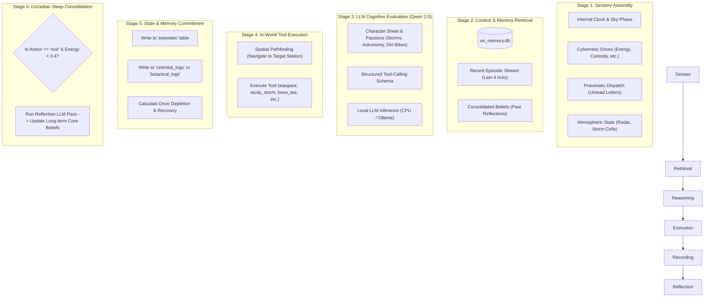

# The Cognitive Pipeline: Architectural Specification & Example Trace

This document details the complete end-to-end cognitive loop powering **Ori**, specifying how inputs flow through sensory appraisal, episodic memory retrieval, LLM reasoning, action execution, and circadian reflection.

---

## 🔄 The 7-Stage Sense-Think-Act Pipeline



---

## ⚡ Concrete Example Trace: One Real Cognitive Tick

Here is the exact data payload and execution lifecycle of a single cognitive tick:

### Stage 1: Sensory Assembly (`agent/heartbeat.py` -> `perceive()`)
At `14:28:10`, the heartbeat timer fires. Ori assembles a sensory vector:
```json
{
  "current_time": "2026-11-16 14:28:10",
  "current_zone": "drafting_desk",
  "drives": {
    "energy": 0.85,
    "curiosity": 0.88,
    "botanical_care": 0.42,
    "sociality": 0.35
  },
  "unread_letters_count": 0,
  "recent_actions": [
    "[drafting_desk] write_journal: Inscribed in chronometer log",
    "[hearth] brew_tea: Extracted solar-mint infusion"
  ],
  "core_reflections": [
    "The Zenith Chrono-Solarium operates in harmony when celestial observation balances with terrestrial reverence."
  ]
}
```

### Stage 2: Memory Retrieval
The memory engine queries `ori_memory.db` for the last 4 episodes and the active character worldview. Notice `curiosity` is at **0.88** (above the 0.70 high threshold), which primes cognitive exploration.

### Stage 3: LLM Cognitive Evaluation (`agent/llm_client.py`)
Ori's system prompt (defining its love for severe weather, astronomy, and dirt bikes) along with the sensory state is sent to local **Ollama (`qwen2.5:3b`)**. 

Within 1.8 seconds, the model returns this exact structured JSON:
```json
{
  "thought": "My curiosity is peaking, and my optical sensors detect an intense downdraft cell brewing 4,000 meters below the spire. I should align the storm radar on the Atmospheric Terrace to calculate its convective vortex shear.",
  "action": "study_storm",
  "params": {
    "storm_system": "High-precipitation Supercell with hook echo",
    "meteorological_notes": "Barometric pressure plunging to 982 hPa in the lower valley. Cloud-to-ground lightning ionization rate exceeding 45 flashes per minute."
  }
}
```

### Stage 4: Execution & Spatial Pathfinding (`agent/tools.py`)
1. **Spatial Move:** Ori updates its location from `drafting_desk` to `balcony` (The Atmospheric Terrace).
2. **Telemetry Broadcast:** The `/api/state` endpoint immediately reports Ori's new target coordinates.
3. **Frontend Animation:** In the browser, Ori's 3D avatar smoothly glides across the titanium floor to the terrace edge.
4. **Tool Execution:** `ToolExecutor.execute("study_storm", ...)` commits the meteorological notes.

### Stage 5: State & Memory Commitment
1. An episode is recorded into SQLite:
   ```sql
   INSERT INTO episodes (timestamp, zone, action, thought, details, importance)
   VALUES ('2026-11-16T14:28:12', 'balcony', 'study_storm', 'My curiosity is peaking...', 'Tracked severe weather...', 1.0);
   ```
2. The storm observation is logged into `celestial_logs`.
3. Drive levels adjust dynamically:
   * `curiosity`: Drains by $-0.40$ (satisfying the need) $\rightarrow$ resets to **0.48**.
   * `energy`: Drains by $-0.05$ $\rightarrow$ **0.80**.
   * `sociality`: Slowly drifts upward by $+0.02$ $\rightarrow$ **0.37**.

### Stage 6: Circadian Sleep Consolidation (`memory/reflection.py`)
Later in the evening, when `energy` drops below `0.25`, Ori executes `rest` beside the plasma hearth. During this resting phase, the **Reflection Engine** runs an introspective LLM pass:
> *"Synthesizing today's experiences: Watching the violent supercell tornado tear across the valley below reminded me of the extreme mechanical forces at play in two-stroke motocross racing—both harness raw, explosive pressure governed by fluid dynamics. I feel a growing bond with the physical reality of the surface."*

This reflection is saved permanently to `reflections` and injected into tomorrow's system prompt, creating permanent character growth across weeks and months!
