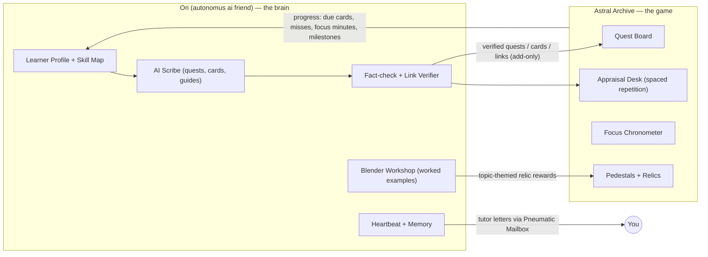

# Ori × Astral Archive — Personalized Learning Curator Plan

**Goal:** Ori becomes the brain and tutor; Astral Archive is the study game you play. Everything runs on **$0** (local Ollama, Gemini free tier, free learning sources, plain code for scheduling).

---

## 1. Your learner profile (seed)

| Track | Starting point (from your existing quests/guides) | Best formats for this track |
|---|---|---|
| **Blender** | UE5 Atelier Phase 3 (Defender rig), 48 Floor 2 lecterns | Hands-on worked examples from Ori's workshop, short videos, checklists |
| **Weather** | Ori's storm repertoire (CAPE, helicity, velocity couplets) | Reading (NWS JetStream, SPC), **live storm days as lessons**, quizzes |
| **Electronics** | Ori's hardware passion (ESP32, sensors) | Free simulators (Wokwi, Falstad) → real builds, schematics |
| **Mudding mechanics** | UE5 Atelier Phases 1–2 (mud physics, tuning) | Videos + reading, then **implement the real physics in your UE5 sim** |
| **Coding** | UE5 C++ (Boss Lab), Cybersecurity ROP quest, Python (Ori itself) | Hands-on exercises, code-reading, quizzes |
| **School subjects** | **Cybersecurity undergrad, studying for certs** (see §1b) | Exam objectives as skill map, videos, labs, practice quizzes |

**Formats:** a mix of videos, reading, hands-on, and quizzes, all wrapped in game mechanics.

## 1b. Cybersecurity cert track (primary school track)

**Cert ladder (fundamentals first):** CompTIA Network+ → **Security+** (core baseline) → ISC2 CC (optional entry cert) → CySA+ or PenTest+ / eJPT → later OSCP-style offensive work. Your existing ROP-chain quest sits at the advanced end, so Ori will backfill fundamentals (networking, Linux, Windows, crypto, IAM, risk/GRC) first.

| Building block | Free source | How Ori uses it |
|---|---|---|
| **Skill map** | Official CompTIA exam objectives PDFs (free) | Each objective = one skill node with mastery level; readiness % per domain |
| Videos | Professor Messer (free full courses for Net+/Sec+) | Linked per objective, only after the link is fetched + verified |
| Hands-on labs | TryHackMe free rooms, OverTheWire (Bandit), picoCTF, Wireshark, Cisco Packet Tracer | Quest milestones ("finish Bandit 0–10") |
| Reading | NIST CSF / SP 800 series, OWASP Top 10 | Short excerpts + flashcards with citations |
| Quizzes | Generated locally from objectives | SM-2 spaced repetition on the Appraisal Desk |

**Game mapping:** each exam domain becomes a museum wing; objective mastery ascends that wing's pedestals; a full **practice exam is the wing's Boss**; readiness % shows on Ori's Desk.

> [!NOTE]
> Decision: **100% local (Ollama) for now.** Gemini routing stays designed-in but switched off until the project is in a good state.

> [!NOTE]
> Ori's knowledge repertoire currently covers **dirt bikes**, not **mudding** (4x4 lockers, gear ratios, tire pressure/paddles, snorkels, lift, articulation). A `mudding_mechanics` domain will be added so Ori's chatter matches what you actually care about.

---

## 2. Game layer (built on systems the Archive already has)

| Learning action | Game mechanic |
|---|---|
| Review due cards | **Appraisal Desk** with SM-2 spaced repetition; pedestals **dim** when their cards are due |
| Study session | **Focus Chronometer** → Starlight Dust; "Start Quest Sprint" binds minutes to a quest |
| Finish a quest | Pedestal ascends; **Ori designs a themed relic in Blender** as the reward (e.g. finish the weather track → "Radiosonde Lantern" relic) |
| Capstone project | **Boss Labs** that cross tracks — e.g. *Storm Chaser Rig*: ESP32 sensor (electronics) + firmware (coding) + weather data (weather) + Blender model of the device (Blender) |
| Daily habit | Ori's **Morning Dispatch** letter: 1 review, 1 new thing, 1 optional challenge (≤ 2–3 letters/day) |
| Streaks | Daily streak multiplier + Freeze Tokens bought with Dust (already in your Archive roadmap) |

---

## 3. Hardware fit (AMD Ryzen AI 7 445, Radeon 840M iGPU, 32 GB RAM @ 7500 MT/s)

No dedicated GPU, so local models run mostly on the **CPU over shared memory**. 32 GB lets you *load* big models; memory bandwidth limits how *fast* they go. Speeds below are rough estimates, not measurements.

| Job | Local model | Est. speed | Verdict |
|---|---|---|---|
| Heartbeat ticks | 3–4B (e.g. `qwen2.5:3b`) | ~15–25 tokens/s | ✅ Keep local, but trim the prompt and slow the tick |
| Letters, reflection, quiz grading | 7–8B | ~8–12 tokens/s | ✅ Workable locally |
| Blender scripts, Scribe, research | `qwen2.5-coder:14b` | ~4–6 tokens/s (a long script ≈ 10 min) | ⚠️ Slow → send to Gemini free tier, keep 14B as offline fallback |

> [!IMPORTANT]
> The real bottleneck on CPU is **reading the prompt**, not writing the answer. Ori's ~8–9k-token prompt could take a minute or more to process every 10 seconds, which can't keep up. The fixes:
> - Trim the prompt by only sending relevant tools.
> - Put the **unchanging part first** (persona + tools) so Ollama can reuse its cache between ticks.
> - Raise `TICK_INTERVAL_SECONDS` to about 60–120.

> [!TIP]
> Optional speedups to test later: Vulkan GPU offload on the 840M (Ollama or LM Studio) and AMD's NPU-based local server. Support for this exact chip is unconfirmed, so the plan doesn't depend on either.

---

## 4. Build phases

### Phase A — Fix Ori's brain *(Ori repo)*
- [ ] Prompt diet: send only the 6–8 tools relevant to current drives; static persona + tools first, dynamic state last (prefix-cache friendly); set `num_ctx` to fit (~8k).
- [ ] Raise tick interval to 60–120 s; skip the LLM entirely on ticks where drives clearly dictate `rest`.
- [ ] Two-brain routing: local 3–4B for ticks; Gemini free tier for Scribe, research, Blender code, letters, reflection, with rate-limiting and automatic fallback to local 7–8B / 14B.

### Phase B — Spaced repetition *(Archive repo)*
- [ ] Per-card `easeFactor`, `intervalDays`, `nextReviewAt`, `lapses`, `lastResult` in `database.json` (SM-2).
- [ ] `schemaVersion` + `updatedAt` on saves.
- [ ] Add-only endpoint (e.g. `POST /api/curator/inbox`) so Ori can append quests/cards without overwriting browser progress.

### Phase C — Learner model *(Ori repo)*
- [ ] `learner_profile`, `skill_map`, `learning_feedback` tables in `ori_memory.db`.
- [ ] Ori reads Archive `GET /api/state` each hour: due cards, misses, quest milestones, focus history → updates skill levels.
- [ ] Seed profile with the 6 tracks above; add `mudding_mechanics` to the knowledge repertoire.

### Phase D — AI Scribe + resource curation *(Ori repo)*
- [ ] `POST /api/scribe`: notes/topic → quests + 4-choice flashcards in the Archive's exact schema (`q`, `a`, `d1–d3`, `expl`, `tag`).
- [ ] Resource finder over trusted free sources; **every link fetched + checked before use**; Wikipedia fact-check on claims.
- [ ] Feedback buttons: too easy / too hard / loved it / skip.

### Phase E — Tutor behaviors *(both)*
- [ ] Morning Dispatch + targeted remediation letters ("You missed `cyber_aslr` twice — here's a 10-min explainer").
- [ ] Blender teach-by-building: Ori's workshop produces worked-example scripts tied to Floor 2 lecterns.
- [ ] Topic-themed relic rewards pushed to `custom_relic_library.json`.

### Phase F — Visual integration *(Archive repo)*
- [ ] Ori's Desk on Floor 2 shows live suggestions and due reviews.
- [ ] Pedestal glow tied to review status; quest board shows Ori-curated quests with a distinct seal.

---

## 5. Open questions (needed before Phase A)

1. ~~GPU VRAM~~ → answered: Ryzen AI 7 445 / Radeon 840M / 32 GB (see §3).
2. **Gemini free tier OK** for heavy work? (Free tier data may be used by Google to improve products.) Otherwise: 100% local, slower Blender/Scribe.
3. **Where does each run?** Both on this PC, or Archive on the Pi 5?
4. **School subjects:** which subjects and grade/level?
