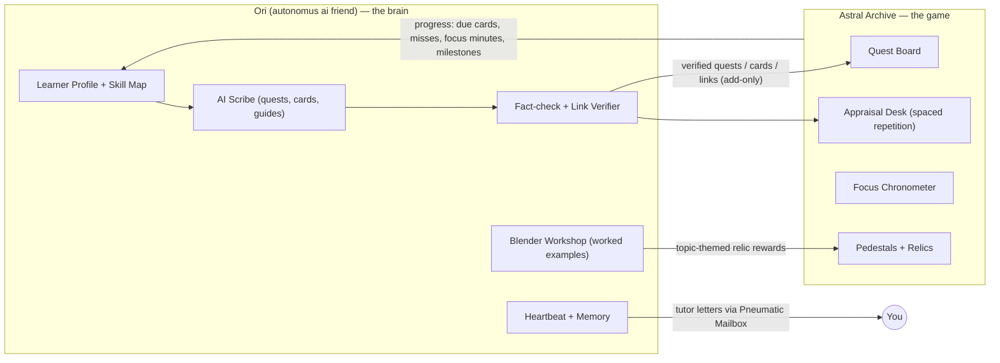

# Ori × Astral Archive — Personalized Learning Curator Plan

**Goal:** Ori becomes the brain and tutor; Astral Archive is the study game you play. Everything runs on **$0** (local Ollama, Gemini free tier, free learning sources, plain code for scheduling).

---

## 1. Your learner profile (seed)

| Track | Starting point (from your existing quests/guides) | Best formats for this track |
|---|---|---|
| **Blender & 2.5D Art** | UE5 Atelier Phase 3, 48 Floor 2 lecterns, pixel-sheet baking (`bake_ori_pixel_sheet.py`) | **Stardew Valley × Octopath Traveler (HD-2D / 2.5D)** pixel sprites, 2.5D billboards, & small low-poly relic props (heavy 3D models archived/separate) |
| **Weather** | Ori's storm repertoire (CAPE, helicity, velocity couplets) | Reading (NWS JetStream, SPC), **live storm days as lessons**, quizzes |
| **Electronics** | Ori's hardware passion (ESP32, sensors) | Free simulators (Wokwi, Falstad) → real builds, schematics |
| **Mudding mechanics** | UE5 Atelier Phases 1–2 (mud physics, tuning) | Videos + reading, then **implement the real physics in your UE5 sim** |
| **Coding** | UE5 C++ (Boss Lab), Cybersecurity ROP quest, Python (Ori itself) | Hands-on exercises, code-reading, quizzes |
| **School subjects** | **Cybersecurity undergrad, studying for certs** (see §1b) | Exam objectives as skill map, videos, labs, practice quizzes |

**Formats:** a mix of videos, reading, hands-on, and quizzes, all wrapped in game mechanics.

## 1b. Cybersecurity cert track (primary school track)

**Cert ladder (fundamentals first):** CompTIA Network+ → **Security+** (core baseline) → ISC2 CC (optional entry cert) → CySA+ or PenTest+ / eJPT → later OSCP-style offensive work. Your existing ROP-chain quest sits at the advanced end, so Ori will backfill fundamentals (networking, Linux, Windows, crypto, IAM, risk/GRC) first.

| Building block | Free source | How Ori uses it |
|---|---|---|
| **Skill map** | Official CompTIA exam objectives PDFs (free) | Each objective = one skill node with mastery level; readiness % per domain |
| Videos | Professor Messer (free full courses for Net+/Sec+) | Linked per objective, only after the link is fetched + verified |
| Hands-on labs | TryHackMe free rooms, OverTheWire (Bandit), picoCTF, Wireshark, Cisco Packet Tracer | Quest milestones ("finish Bandit 0–10") |
| Reading | NIST CSF / SP 800 series, OWASP Top 10 | Short excerpts + flashcards with citations |
| Quizzes | Generated locally from objectives | SM-2 spaced repetition on the Appraisal Desk |

**Game mapping:** each exam domain becomes a museum wing; objective mastery ascends that wing's pedestals; a full **practice exam is the wing's Boss**; readiness % shows on Ori's Desk.

> [!NOTE]
> Decision: **100% local (Ollama) for now.** Gemini routing stays designed-in but switched off until the project is in a good state.

> [!NOTE]
> Ori's knowledge repertoire currently covers **dirt bikes**, not **mudding** (4x4 lockers, gear ratios, tire pressure/paddles, snorkels, lift, articulation). A `mudding_mechanics` domain will be added so Ori's chatter matches what you actually care about.

---

## 2. Game layer (built on systems the Archive already has)

| Learning action | Game mechanic |
|---|---|
| Review due cards | **Appraisal Desk** with SM-2 spaced repetition; pedestals **dim** when their cards are due |
| Study session | **Focus Chronometer** → Starlight Dust; "Start Quest Sprint" binds minutes to a quest |
| Finish a quest | Pedestal ascends; **Ori designs a themed relic in Blender** as the reward (e.g. finish the weather track → "Radiosonde Lantern" relic) |
| Capstone project | **Boss Labs** that cross tracks — e.g. *Storm Chaser Rig*: ESP32 sensor (electronics) + firmware (coding) + weather data (weather) + Blender model of the device (Blender) |
| Daily habit | Ori's **Morning Dispatch** letter: 1 review, 1 new thing, 1 optional challenge (≤ 2–3 letters/day) |
| Streaks | Daily streak multiplier + Freeze Tokens bought with Dust (already in your Archive roadmap) |

---

## 3. Hardware fit (AMD Ryzen AI 7 445, Radeon 840M iGPU, 32 GB RAM @ 7500 MT/s)

No dedicated GPU, so local models run mostly on the **CPU over shared memory**. 32 GB lets you *load* big models; memory bandwidth limits how *fast* they go. Speeds below are rough estimates, not measurements.

| Job | Local model | Est. speed | Verdict |
|---|---|---|---|
| Heartbeat ticks | 3–4B (e.g. `qwen2.5:3b`) | ~15–25 tokens/s | ✅ Keep local, but trim the prompt and slow the tick |
| Letters, reflection, quiz grading | 7–8B | ~8–12 tokens/s | ✅ Workable locally |
| Blender scripts, Scribe, research | `qwen2.5-coder:14b` | ~4–6 tokens/s (a long script ≈ 10 min) | ⚠️ Slow → send to Gemini free tier, keep 14B as offline fallback |

> [!IMPORTANT]
> The real bottleneck on CPU is **reading the prompt**, not writing the answer. Ori's ~8–9k-token prompt could take a minute or more to process every 10 seconds, which can't keep up. The fixes:
> - Trim the prompt by only sending relevant tools.
> - Put the **unchanging part first** (persona + tools) so Ollama can reuse its cache between ticks.
> - Raise `TICK_INTERVAL_SECONDS` to about 60–120.

> [!TIP]
> Optional speedups to test later: Vulkan GPU offload on the 840M (Ollama or LM Studio) and AMD's NPU-based local server. Support for this exact chip is unconfirmed, so the plan doesn't depend on either.

---

## 3b. Raspberry Pi 5 Deployment & Split-Host Topology

Both projects support the Raspberry Pi 5, and `ASTRAL_ARCHIVE_URL` in Ori's `.env` lets you run them on the same machine or split them across your home network without code changes:

| Setup | Where Ori runs | Where Archive runs | `ASTRAL_ARCHIVE_URL` | Best for |
|---|---|---|---|---|
| **1. Both on PC (current)** | Laptop (`:8888`) | Laptop (`:8080`, `server.ps1`) | `http://localhost:8080` | Fast local dev & Blender workshop |
| **2. Split: Archive on Pi 5, Ori on PC** *(recommended 24/7 study)* | Laptop (`:8888`) | Pi 5 (`:3000`, `server.js` + `systemd`) | `http://raspberrypi.local:3000` | Always-on study game from phone/tablet/PC while Ori keeps 32 GB RAM + Blender 4.5.15 |
| **3. Both on Pi 5** *(full appliance)* | Pi 5 (`:8888`, `deploy_pi.sh` + `ori.service`) | Pi 5 (`:3000`, `server.js`) | `http://localhost:3000` | 24/7 standalone companion with zero PC power draw |

### Pi 5 constraints, space, RAM & porting gotchas
- **Hardware:** Pi 5 **8 GB** recommended (4 GB minimum) with **Active Cooler** + **27W USB-C PSU**. Sustained Ollama ticks peg all 4 cores; without active cooling the Pi thermal-throttles (2.4 GHz → 1.5 GHz) and without 27W power it can brown out USB/Wi-Fi.
- **Disk space budget (~12–16 GB total on Pi):**
  - Ori runtime (`agent/`, `memory/`, `services/`, `config/`, `web/`, `ori_memory.db`): **~15 MB** (excluding `Ori.blend`/`Ori.blend1` ~23.4 MB, which aren't needed on Pi).
  - Astral Archive active app: **~1.6 MB** (the ~2.19 GB `Oris relic refrences/` archive stays on PC).
  - Ollama + model weights: **~3–4.5 GB** (`qwen2.5:3b` is ~2.5 GB, `qwen2.5:1.5b` is ~1.1 GB).
  - 64-bit OS + logs + backups: **~6–9 GB**.
  - **Target storage:** **32 GB+ Class A2 microSD** minimum, or **64 GB+ / USB 3.0 NVMe SSD** (strongly recommended).
- **RAM budget (8 GB vs 4 GB):**
  - OS + Python (`main.py`) + Node (`server.js`): **~1.0–1.3 GB**.
  - Ollama + `qwen2.5:3b` at `OLLAMA_NUM_CTX=8192`: **~3.0–3.5 GB** (weights + KV cache) → **~4.0–4.8 GB total** (comfortable on 8 GB).
  - **On a 4 GB Pi:** `qwen2.5:3b` at 8k context will swap/OOM. Drop to `qwen2.5:1.5b` (~1.1 GB) and `OLLAMA_NUM_CTX=4096`.
  - **One model in RAM:** Set `OLLAMA_DEEP_MODEL` equal to `OLLAMA_MODEL` (`qwen2.5:3b`) on Pi 5 so Ollama never swaps two models in and out of memory.
- **Keep `chromadb` off the Pi:** `chromadb` is listed in `requirements.txt` (unused right now) and pulls heavy ARM64 deps (`onnxruntime`, etc.). Keep it skipped on Pi 5 and use SQLite (`ori_memory.db`) unless needed later.
- **SD card wear & power-loss safety:** Heartbeat ticks write to `ori_memory.db` and Archive writes `database.json`. Enable SQLite `WAL` mode (`journal_mode=WAL`), keep nightly backups, and prefer a USB 3.0 NVMe SSD over microSD for 24/7 writes.
- **Visual & World Direction (Stardew Valley × Octopath Traveler):** Both worlds are moving toward a cohesive **2.5D / HD-2D pixel-art style** (2D sprites, layered 2.5D depth, warm lantern/hearth lighting, tile-based rooms). Most heavy 3D models stay **archived or in separate files**, keeping only lightweight pixel sheets and optional small low-poly relics for the in-modal inspector. This also cuts disk/RAM/bandwidth for **Pi 5** and mobile browsers.
- **Blender Workshop:** Blender relic/sprite generation stays on the PC; finished 2.5D sprite sheets or lightweight `.glb`s sync to the Pi 5 via `Bossman-samb/astral-archive` and `copy-to-pi.bat`. On Pi 5, leave `BLENDER_PATH` empty and run `athenaeum/server.js` (Node), not `server.ps1`.
- **Timing & offline LAN:** Keep `TICK_INTERVAL_SECONDS=90` (or `120`) and `OLLAMA_TIMEOUT_SECONDS=300` so ticks don't pile up. Vendor Three.js locally in `athenaeum/public/vendor/` so the 3D Relic Rotator works offline on LAN, and use a static router IP (or `raspberrypi.local`) + Tailscale/Cloudflare Tunnel for HTTPS/PWA on your phone.

---

## 4. Build phases

### Phase A — Fix Ori's brain *(Ori repo — Done)*
- [x] Prompt diet: `agent/tool_selector.py` sends only the 6–8 tools relevant to current drives; static persona + voice rules first, dynamic state last (prefix-cache friendly); shared `OLLAMA_NUM_CTX=8192`.
- [x] Raised `TICK_INTERVAL_SECONDS=90`; deep-sleep ticks (`energy < 0.15`, no unread letter) skip the LLM entirely.
- [x] Local two-brain routing: `qwen2.5:3b` for routine ticks; `OLLAMA_DEEP_MODEL=qwen2.5:7b` for letter replies & nightly reflection (auto-falls back to `3b` if `7b` isn't pulled); `ASTRAL_ARCHIVE_URL` configurable. *(Gemini routing remains ready for later.)*

### Phase B — Spaced repetition *(Archive repo)*
- [ ] Per-card `easeFactor`, `intervalDays`, `nextReviewAt`, `lapses`, `lastResult` in `database.json` (SM-2).
- [ ] `schemaVersion` + `updatedAt` on saves.
- [ ] Add-only endpoint (e.g. `POST /api/curator/inbox`) so Ori can append quests/cards without overwriting browser progress.

### Phase C — Learner model *(Ori repo)*
- [ ] `learner_profile`, `skill_map`, `learning_feedback` tables in `ori_memory.db`.
- [ ] Ori reads Archive `GET /api/state` each hour: due cards, misses, quest milestones, focus history → updates skill levels.
- [ ] Seed profile with the 6 tracks above; add `mudding_mechanics` to the knowledge repertoire.

### Phase D — AI Scribe + resource curation *(Ori repo)*
- [ ] `POST /api/scribe`: notes/topic → quests + 4-choice flashcards in the Archive's exact schema (`q`, `a`, `d1–d3`, `expl`, `tag`).
- [ ] Resource finder over trusted free sources; **every link fetched + checked before use**; Wikipedia fact-check on claims.
- [ ] Feedback buttons: too easy / too hard / loved it / skip.

### Phase E — Tutor behaviors *(both)*
- [ ] Morning Dispatch + targeted remediation letters ("You missed `cyber_aslr` twice — here's a 10-min explainer").
- [ ] Blender teach-by-building: Ori's workshop produces worked-example scripts tied to Floor 2 lecterns.
- [ ] Topic-themed relic rewards pushed to `custom_relic_library.json`.

### Phase F — Visual integration *(Archive + Ori)*
- [ ] Unify around **Stardew Valley × Octopath Traveler (2.5D / HD-2D)** visuals: sprite sheets, 2.5D pedestals, warm lighting, and archive/separate heavy 3D world models.
- [ ] Ori's Desk on Floor 2 shows live suggestions and due reviews.
- [ ] Pedestal glow tied to review status; quest board shows Ori-curated quests with a distinct seal.

---

## 5. Decisions locked in

1. **Hardware:** Ryzen AI 7 445 / Radeon 840M / 32 GB RAM (see §3); optional Pi 5 deployment (see §3b).
2. **Model mode:** **100% local (Ollama)** for now (`qwen2.5:3b` + `qwen2.5:7b`), until the project is in a good state.
3. **Host layout:** Configurable via `ASTRAL_ARCHIVE_URL` (same PC or Archive on Pi 5 / another machine).
4. **School track:** **Cybersecurity undergrad, focusing on fundamentals & certs** (Network+, Security+, ISC2 CC, CySA+/PenTest+; see §1b).
