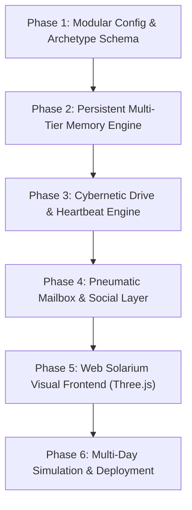

# Master Execution Plan: Autonomous AI Companion ("Ori")

This phased roadmap outlines the complete end-to-end development of Ori, the Clockwork Solarium Apprentice. Each phase is self-contained, strictly ordered to prevent duplication or premature dependencies, and verifiable.

---

## 🗺️ Phase Overview & Dependency Graph

---

## 📋 Detailed Execution Phases

### Phase 1: Configuration & Archetype Decoupling
*Goal: Separate agent personality, world parameters, and secrets from core runtime code.*
- [ ] **1.1 Persona Configuration:** Create `config/persona.json` with Ori's lore, voice prompts, zone coordinates, and botanical/astronomical seed tables.
- [ ] **1.2 Dynamic LLM Provider Client:** Implement `agent/llm_client.py` supporting Gemini, OpenAI, Claude, or local Ollama/vLLM endpoints with structured JSON / tool calling.
- [ ] **1.3 Environment & Secrets Setup:** Update `.env.example` and validation schemas for API keys, tick rates, and storage paths.

### Phase 2: Persistent Multi-Tier Memory Engine
*Goal: Give Ori permanent memory across restarts with Stanford Generative Agent reflection capabilities.*
- [ ] **2.1 SQLite Relational Store:** Build `memory/sqlite_store.py` for structured persistence:
  - `episodes`: Timestamped observations, tool actions, and emotions.
  - `reflections`: Nightly synthesized beliefs and identity evolutions.
  - `botanical_logs`: Terrarium state, plant growth, and herbal recipes.
  - `correspondence`: Letters sent to and received from the user.
- [ ] **2.2 Semantic Vector Retrieval:** Implement vector embeddings and recency-decay scoring.
- [ ] **2.3 Sleep-State Reflection Loop:** Build the consolidation pipeline that runs when Ori sleeps, clustering recent memories into core worldview updates.

### Phase 3: Cybernetic Drive & Autonomous Heartbeat Loop
*Goal: Replace simulated actions with genuine unprompted LLM reasoning and real tool execution.*
- [ ] **3.1 Cybernetic Needs Engine:** Implement `agent/drives.py` calculating dynamic rates for `energy`, `curiosity`, `botanical_care`, and `sociality`.
- [ ] **3.2 Cognitive Decision Loop:** Upgrade `agent/heartbeat.py` to:
  1. Assemble sensory snapshot (time, weather, drive levels, current zone).
  2. Query memory engine for relevant context.
  3. Execute LLM decision with structured tool calling.
- [ ] **3.3 In-World Tool Suite:**
  - `stargaze`: Observe constellations and write celestial notes.
  - `tend_flora`: Water/mist terrariums, harvest leaves, check plant growth.
  - `brew_tea`: Combine dried herbs and record tasting impressions.
  - `write_journal`: Record daily philosophical musings.
  - `rest`: Wind down springwork to restore energy.

### Phase 4: The Pneumatic Mailbox & Social Layer
*Goal: Enable graceful, non-intrusive asynchronous communication between Ori and the user.*
- [ ] **4.1 Mailbox Dispatch Engine:** Build `social/mailbox.py` handling inbound letters, unread queues, and rate-limiting cooldowns (max 2-3 spontaneous letters per day).
- [ ] **4.2 Letter Composition Tool:** Implement `send_letter` tool for Ori to write thoughtful inquiries and share sketches or tea notes.
- [ ] **4.3 User Interface Adapter:** Provide lightweight interfaces to read and reply:
  - CLI terminal mailbox command.
  - Optional Discord or Telegram bot integration for real-time notifications on mobile.

### Phase 5: The Cloud Solarium 3D Web Frontend
*Goal: Provide a persistent, ambient visual space to observe Ori living in real time.*
- [ ] **5.1 World State API & WebSockets:** Build a lightweight FastAPI server (`server.py`) streaming Ori's real-time position, current activity, and clock.
- [ ] **5.2 Three.js / WebGL Scene:** Create the circular glass-domed observatory:
  - Procedural rolling cloud sea below the floor.
  - Day/night lighting linked to the real clock.
  - 5 interactive zones (Astrolabe, Conservatory, Desk, Hearth, Mailbox).
- [ ] **5.3 Character Renderer & Animation:** Low-poly stylized brass automaton that paths between stations, displays state icons (e.g. resting, drafting), and animates gears.

### Phase 6: Multi-Day Simulation, Hardening & Deployment
*Goal: Ensure long-term stability, zero memory leaks, and seamless 24/7 background operation.*
- [ ] **6.1 Time-Warp Simulation Test:** Run a simulated 7-day test in accelerated time to verify memory stability, drive balancing, and reflection synthesis.
- [ ] **6.2 Systemd / Docker Daemonization:** Provide scripts to run Ori 24/7 in the background on local machines, mini-PCs, or a Raspberry Pi.
